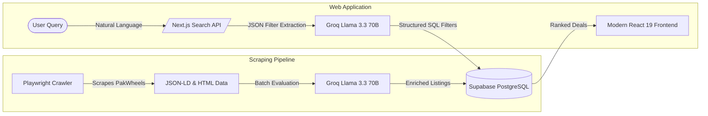

# 🚗 GariLelo AI (گاڑی لے لو AI)

> **An AI-powered intelligent car search engine and deal evaluator engineered specifically for the Pakistani automobile market.**

[](https://nextjs.org/)
[](https://react.dev/)
[](https://groq.com/)
[](https://supabase.com/)
[](https://playwright.dev/)
[](https://tailwindcss.com/)

---

## 📌 Project Overview

**GariLelo AI** revolutionizes used-car discovery in Pakistan. Traditional classified portals require tedious manual browsing across fragmented filters. GariLelo AI enables buyers to search using everyday natural language (e.g., *"automatic fuel-efficient family car under 45 lacs in Lahore"* or *"clean Civic or Corolla for daily commute in Islamabad"*).

The platform translates conversational queries into structured parameters, queries verified PakWheels listings stored in Supabase, and evaluates every vehicle against Pakistani market price benchmarks to rank listings by deal quality.

---

## ⚡ Key Capabilities

- **🧠 Natural Language Search & Query Translation**: Uses **Groq (Llama 3.3 70B Versatile)** with sub-second inference to parse complex, conversational prompts into strict filter schemas (Make, Model, Price Range in PKR/Lacs/Crores, Transmission, Body Type, Fuel Type, City, Engine Capacity, and Semantic Keywords).
- **📊 Real-time Visual Sliders & Interactive Filters**: Instant reactive client-side and server-side filtering with interactive sliders for price range, year, engine capacity, AI score threshold, and body types.
- **🔍 Deep Web Scraper (Playwright)**: Headless Chromium engine crawling PakWheels with JSON-LD microdata parsing, selector fallbacks, full location capturing, and automated Pakistani currency normalization (handles *Lacs*, *Crores*, and *Call for Price*).
- **🏷️ Automated AI Deal Scoring & Summaries**: Evaluates vehicle health, mileage-per-year ratios, and price fairness against realistic market context. Generates a 1–10 deal score, rating labels (*Exceptional Deal*, *Good Deal*, *Fair Price*, *Overpriced*), and an insightful single-sentence evaluation.
- **🎨 Award-Winning UI/UX**: Premium modern aesthetic featuring glassmorphism, Framer Motion micro-interactions, responsive grid cards, and seamless Light/Dark mode toggling.
- **⏱️ Automated CI/CD Data Pipeline**: GitHub Actions cron jobs (`.github/workflows/scraper-cron.yml`) run scheduled scrapes every 12 hours with automated 60-day garbage collection.

---

## 🛠️ Tech Stack Architecture



### 1. Frontend & Client Layer
- **Framework**: [Next.js 16](https://nextjs.org/) (App Router, Turbopack, Server & Client Components)
- **Library**: [React 19](https://react.dev/)
- **Styling**: [Tailwind CSS v4](https://tailwindcss.com/) with CSS Variables & Dark Theme Support
- **Animations**: [Framer Motion](https://www.framer.com/motion/)
- **Icons**: Lucide React & Custom Brand Vector Graphics

### 2. AI & Large Language Models
- **Provider**: [GroqCloud](https://console.groq.com/)
- **Model**: `llama-3.3-70b-versatile`
- **Use Cases**:
  - Semantic Intent & Filter Extraction from user search queries
  - High-throughput batch evaluation & scoring of vehicle listings

### 3. Backend, Database & Storage
- **Database**: [Supabase](https://supabase.com/) (PostgreSQL 15+)
- **Security**: PostgreSQL Row-Level Security (RLS) with public read access
- **Indexes**: Composite B-tree indexes on `make`, `model`, `price`, `city`, and `ai_score`
- **Garbage Collection**: Automated pruning of listings older than 60 days

### 4. Scraping & Automation
- **Runtime**: Python 3.11+
- **Browser Automation**: [Playwright](https://playwright.dev/python/) (Headless Chromium)
- **Parsing**: `application/ld+json` Schema.org parsing with DOM fallback
- **CI/CD Automation**: GitHub Actions (`schedule` cron + `workflow_dispatch` manual trigger)

---

## 📂 Repository Structure

```text
GariLeloAI/
├── .github/
│   └── workflows/
│       └── scraper-cron.yml     # Automated 12h scraping & evaluation workflow
├── app/
│   ├── api/
│   │   └── search/
│   │       └── route.ts         # Groq LLM filter parsing & Supabase query handler
│   ├── components/
│   │   ├── CarCard.tsx          # Vehicle card with badge, specs & deal metrics
│   │   ├── CarGrid.tsx          # Responsive listing grid & empty states
│   │   ├── FilterBar.tsx        # Interactive sliders & category filters
│   │   ├── HomePage.tsx         # Main interactive client controller
│   │   ├── Navbar.tsx           # Glassmorphic header & dark/light theme switch
│   │   └── SearchHero.tsx       # Conversational search input & query suggestions
│   ├── globals.css              # Design tokens, themes & Tailwind v4 config
│   ├── layout.tsx               # Root application shell
│   └── page.tsx                 # Server entry point
├── public/                      # Static assets & vehicle icons
├── requirements.txt             # Python scraper dependencies
├── scraper.py                   # Playwright web scraper & Groq batch evaluator
├── package.json                 # Next.js & Node dependencies
└── README.md                    # Project documentation
```

---

## 🚀 Getting Started

### 1. Prerequisites
- **Node.js**: v20 or higher
- **Python**: 3.11 or higher
- **Supabase Account**: with a `cars` table configured
- **GroqCloud API Key**: for Llama 3.3 inference

### 2. Environment Setup

Create a `.env.local` file in the project root:

```env
# Supabase
NEXT_PUBLIC_SUPABASE_URL="https://your-project.supabase.co"
NEXT_PUBLIC_SUPABASE_ANON_KEY="your-anon-key"
SUPABASE_SERVICE_ROLE_KEY="your-service-role-key"

# Groq Cloud
GROQ_API_KEY="gsk_your_groq_api_key"
```

### 3. Frontend Setup

```bash
# Install dependencies
npm install

# Start Next.js development server
npm run dev
```

Visit `http://localhost:3000` to interact with the application.

### 4. Running the Scraper

```bash
# Install Python packages
pip install -r requirements.txt

# Install Playwright browser
python -m playwright install chromium

# Execute manual scrape
python scraper.py
```

---

## 🔒 License

Distributed under the MIT License. See `LICENSE` for more information.
